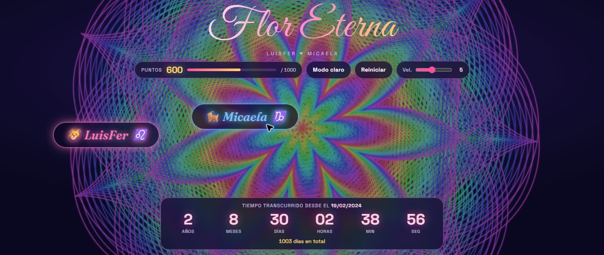
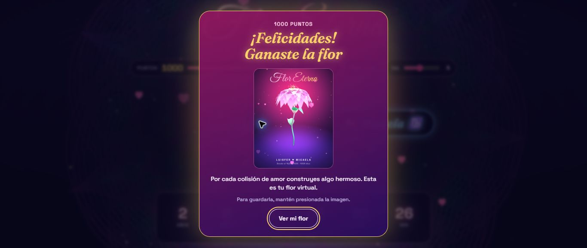
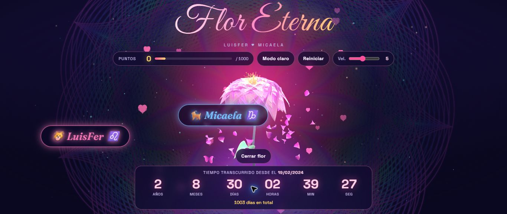

# 🌸 Flor Eterna

**Una página de aniversario interactiva para LuisFer y Micaela.** Un mandala animado, un contador en tiempo real y un minijuego que revela una flor en 3D.

## Cómo jugar

1. Arrastra las etiquetas **🦁 LuisFer ♌** y **🐐 Micaela ♑** con el ratón o con el dedo para que se encuentren.
2. Cada choque suma **100 puntos**. Al llegar a **1.000 puntos**, la flor aparece y se muestra la tarjeta de victoria.
3. Selecciona **Ver mi flor** para regresar a la escena. Arrastra sobre la flor para girarla y usa **Cerrar flor** o **Abrir flor** para cambiar su posición.

## Capturas

### Minijuego y contador



### Tarjeta de victoria



### Flor 3D desbloqueada



## Controles y detalles

| Control o elemento | Qué hace |
| --- | --- |
| **Modo claro / Modo oscuro** | Cambia el tema y recuerda la preferencia en el navegador. |
| **Vel.** | Ajusta la velocidad del mandala de 1 a 10. |
| **Reiniciar** | Restablece la puntuación y oculta la flor para empezar otra ronda. |
| **Contador** | Muestra el tiempo transcurrido desde el **19 de febrero de 2024**, con años, meses, días, horas, minutos y segundos. |
| **Tarjeta de victoria** | Genera una imagen PNG de la flor de 1080 × 1350 px. Si el navegador no muestra un botón de descarga, puedes guardar la vista previa desde su menú de imagen o manteniéndola presionada en el móvil. |

## Ejecutar en local

```bash
git clone https://github.com/luisfernando2607/luisfer-micaela-anniversary.git
cd luisfer-micaela-anniversary
```

Abre **Flor Eterna.html** en un navegador moderno con **WebGL** habilitado. La página carga Three.js y las tipografías desde internet.

## Tecnologías

- **HTML, CSS y JavaScript** para la interfaz, los controles de arrastre, las colisiones y el contador.
- **Canvas 2D** para el mandala animado y la composición del recuerdo.
- **Three.js r128 y WebGL** para la flor 3D, la iluminación y las partículas.

Toda la aplicación está en [Flor Eterna.html](Flor%20Eterna.html). Las capturas y la licencia acompañan al código en la raíz del repositorio.

## Autor y licencia

Proyecto de **Luis Fernando Flores** ([luisfernando2607](https://github.com/luisfernando2607)), dedicado a Micaela. Publicado bajo la [licencia MIT](LICENSE).
